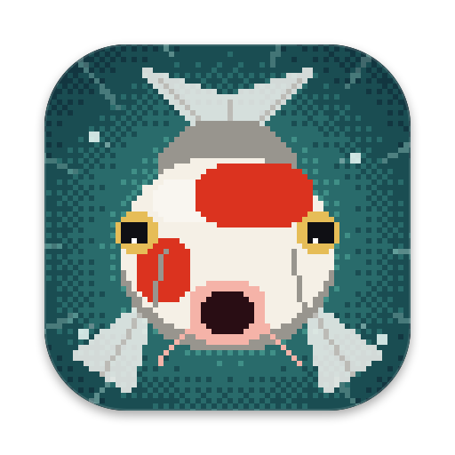

# Koi Pond

<p align="center"></p>

## Download

**[Download Koi Pond for Mac (KoiPond.dmg)](https://github.com/Tiger0821/koi-pond/releases/latest/download/KoiPond.dmg)**:
version 1.0.2, about 2 MB, for macOS 14 or later on Apple silicon.

1. Open `KoiPond.dmg` and drag **Koi Pond** onto **Applications**.
2. Open Koi Pond from Applications. It isn't from the App Store, so the first time macOS may say it can't
   check it: open **System Settings › Privacy & Security**, scroll down, click **Open Anyway** next to Koi Pond
   and open it again (or run `xattr -dr com.apple.quarantine "/Applications/Koi Pond.app"` in Terminal).
3. Your desktop is now a pond. Click the water to feed the fish.

Koi Pond may ask to control Music (for the Now Playing player) and to hear Music's sound (so the fish can
dance to the beat). Both are optional: Settings › General › Privacy › "Listen to Music so the fish can dance"
turns listening off, and then Koi Pond never hears any sound. Rock and Roll lyrics (off at first) look each
new song's lyrics up online, sending its title, artist, album and length to NetEase Cloud Music and LRCLIB.
Every version is on the [releases page](https://github.com/Tiger0821/koi-pond/releases).

## About

A living koi pond behind your Mac desktop icons, inspired by Solas. Koi, small fish, turtles,
lily pads, lotus flowers, plants and weather are simulated live with Metal, not looped video.

## Build and run

```bash
./scripts/build-app.sh
open "/Applications/Koi Pond.app"
```

The script builds **Koi Pond.app** and installs it in `/Applications`, quitting and reopening a copy that's
running; `--no-install` leaves it in `$TMPDIR/koipond-build` instead. `./scripts/make-dmg.sh` packs it into
`build/KoiPond.dmg` for a release: a window with Koi Pond on the left, the Applications shortcut on the right
and a big pixel arrow between them under "Drag Koi Pond onto Applications", on a pond background the app draws
itself (`--dmg-background`), with the first-open tip underneath and the koi as the disk's icon. Finder lays
the window out, so the first run asks once to let Terminal control Finder. It puts the app together in the temporary folder, outside
the project: on an iCloud-synced Desktop, iCloud Drive touches new bundles (leaving "KoiPond 2.app" conflict
copies and Finder data that breaks code signing), and Spotlight would list a second copy. Its icon is the charging pixel koi,
drawn by the app itself (`.build/release/KoiPond --app-icon out.png [--style charge|splash|splat|night|lily]`)
and turned into `AppIcon.icns` for the app and its screen saver.

Koi Pond sits in the Dock and the menu bar (fish icon); Settings › General › Show Koi Pond in can make it
Dock only or menu bar only. Opening it, or clicking its Dock icon, shows the **Home** window: a live pond of its
own at the desktop's proportions (click it to touch the water and feed the fish, press on a koi to pick it
up), a glass bar along its bottom for the weather and the water's color, a pause button, and a card for each
place the pond lives (desktop, lock screen, screen saver, Music) with a switch, its status and a link to its
settings. The preview draws only while the window can be seen. At login it starts without the window.

Everything else is in **Settings** (Command-Comma), a standard Mac settings window with a toolbar of panes:
General, Pond, Fish, Plants, Music, Lock Screen and Performance. Following Apple's settings guidelines, the
window is titled after the pane, sized to it and reopens on the last one; each group of settings has a
one-line note under it, rarely needed options sit under Advanced, and the Pond, Fish, Plants and Performance
panes each have Restore Defaults (Reset All Settings is at the bottom of General). Requires macOS 14 or later.

Run the tests with `swift test`. `defaults write com.koifishwallpaper.koipond DebugLogging -bool true` logs
clicks, what blocked them, frames drawn and skipped, and any stall. To render a frame without opening any windows:

```bash
.build/debug/KoiPond --snapshot pond.png --weather sunset
```

Add `--lineup "ogon@760,520,0.1,110;kigoi:2@740,420,2.9,100"` (variety@x,y,heading,length, in points with y
up) to draw just those koi on bare water, for looking at the fish up close. `:2` picks the variety's third
design; without it you get the first.

To measure CPU, memory, GPU and battery use with few and many animals (about 20 minutes, on battery,
leaving the Mac alone), run `python3 -I scripts/measure-usage.py`. It uses `KoiPond --try-settings
file.json`, which runs the pond with those settings without saving them.

## What it does

- **Living pond:** ten koi varieties (Kohaku, Taisho Sanke, Showa, Tancho, a metallic gold Yamabuki Ogon
  that shines and glints, Asagi with its net scales and red cheeks, a lemon Akame Kigoi with red eyes,
  Chagoi, Shiro Utsuri and Benigoi), schools of small fish, turtles that surface and dive,
  lily pads, lotus or water lily flowers, and underwater plants. The fish are lit from the upper left like
  their shadows, with see-through fins, and their patterns follow show rules: a white nose, clean white
  before the tail, no black on a Sanke's head, black fin roots on Showa and Utsuri, stripes in Sanke fins.
- **Many designs per koi:** most varieties come in several designs, dealt out in turn so koi of one
  variety look different from each other, and none is a single flat colour. At night and at dusk the fish
  keep their own colours, only dimmer, while the water around them goes dark.
  - Kohaku: classic plates, Inazuma (a lightning band), Sandan (three steps, with red lips), Kanoko
    (dapples), Ai-goromo (indigo-edged scales), Goshiki (a blue-grey net) and Fukurin (a light rim on
    every scale).
  - Sanke: classic or Maruten (a round red crown). Showa: classic or with soft sumi-e ink edges.
  - Ogon: Fukurin, Ki Matsuba (pine-cone scales), Kin Kikokuryu (ink clouds) or Hariwake (platinum and gold).
  - Kigoi: a scale net, Gin-rin (sparkling scales), Ki Bekko (black spots) or Ki Utsuri (black and lemon).
  - Chagoi: a scale net, Gin-rin, Ochiba Shigure (grey-blue with bronze leaves) or Doitsu (mirror scales).
  - Benigoi: Aka Matsuba, Gin-rin or Beni Kumonryu (white, black and red swirls).
- **Touch the water:** click bare desktop for ripples. With **Feed the Fish** on, a click drops
  food (at most one click every 0.05 s counts, so an auto clicker can't swamp the pond). Clicks on windows, widgets, the Dock or menus are
  ignored, and icons keep working because the pond never takes the click.
- **Weather:** Sunny, Crystal, Dawn, Sunset, Twilight, Moonlight, Rain (ripples and streaks) and
  Storm (lightning), or Follow Device Time to drift from dawn to moonlight with the clock.
- **Make it yours:** water color, clarity, ripples, currents (strength, speed, core glow), animal
  counts, koi behavior (Calm, Curious, Shy, Schooling), motion speed, blooms and plants.
- **Rock and Roll lyrics:** the song's synced lyrics play big in the middle of the pond, slamming in word
  by word to the beat, while the pond dims a little behind them (see below).
- **Quiet:** always pixel art, which is light on battery; 15–120 fps. It slows or pauses on battery and
  in Low Power Mode, and rests while the Mac sleeps, the screen is locked, or windows cover a display.

## Lock screen

Turn on **Show the pond on the lock screen** in Settings › Lock Screen (or the Lock Screen card on the Home window). Koi Pond records a 3-minute pond video (about 80 s of
work, ~120 MB) and swaps it into one of your downloaded Apple aerials in
`~/Library/Application Support/com.apple.wallpaper/aerials/videos` (macOS 26+). Apple's movie is
moved to `~/Library/Application Support/KoiPond/LockScreen/` and put back when you turn the
feature off. It also makes that aerial the wallpaper on every Space and display (by editing
`com.apple.wallpaper/Store/Index.plist`, the file System Settings › Wallpaper writes; a copy from
before the first change is kept in `~/Library/Application Support/KoiPond/`), so the pond plays on the
lock screen, in Mission Control and while switching Spaces. Turning it off restores the previous
wallpaper wherever you haven't picked a new one since. It re-records when you
change how the pond looks, or when Follow Device Time moves into a new part of the day. The cold-boot
FileVault screen stays static, and a macOS update may restore Apple's movie. macOS plays the movie with
its aerial renderer (`WallpaperAerialsExtension`), which slows it to a stop on unlock by dropping HEVC
temporal layers, so the recording is encoded in two (a 15 fps base layer and the frames between), like
Apple's aerials; a movie without them makes that slow-down fail, and the renderer's player then empties its
layers (every Space's wallpaper, and so its Mission Control thumbnail, turns black) and ignores every later
lock. On macOS 27 the wallpaper agent never restarts the renderer if it stops on its own; Koi Pond checks on it
at launch, every 15 minutes and after each unlock or screen saver, and restarts the agent (which brings the
renderer back) if it's gone, or restarts both if the log shows its player stuck. Technique from the
MIT-licensed [Animated](https://github.com/vlzuiev/animated).

## Screen saver

Turn on **Use the pond as the screen saver** in Settings › Lock Screen. The app installs `KoiPond.saver` (built into the app) to
`~/Library/Screen Savers`, keeps its `settings.json` in step with your pond settings, and makes it the
screen saver on every Space. Unlike the lock screen video, the screen saver runs the live simulation.
Turning it off removes it and restores your previous screen saver.

## Now Playing

A pixel-art Apple Music player sits on the main display while Music has a song playing or paused. Drag it by
its cover or title: it snaps to the screen's edges and center lines when near them and to a 24-point grid
elsewhere (Settings › Music also has corner buttons and a size): the cover, the title and artist, previous,
play/pause and next buttons, and a progress bar. It is drawn as a 165×49 bitmap scaled up with
nearest-neighbour filtering (titles and artists in Chinese, Japanese, Korean and other intricate scripts are
drawn on the bitmap's finer grid with edge pixels lit in quarter steps, so their strokes stay apart), in a non-activating panel one level above the desktop icons, so its
buttons take clicks without stealing focus. Song changes come from Music's `com.apple.Music.playerInfo`
broadcast; the position, the cover and the buttons use Apple Events, which macOS asks you to allow once
(Privacy & Security › Automation; ad hoc signed rebuilds may ask again). Songs streamed without being
added to the library have no cover in Music, so the player looks them up with Apple's iTunes Search
API. Preview the drawing with `.build/release/KoiPond --now-playing-preview out.png --title … --artist …`.

## Song changes

When Music moves to a new song, the desktop player changes over with one of four pixel transitions, picked
at random: Mosaic Slide (typewriter title, the cover glides in as blocks and sharpens like a Super Nintendo
mosaic), Koi Surface (the cover sinks and the new one surfaces through rippling water), Split-Flap (letters
rattle and lock like a departure board, the cover drops in and bounces) and Dither Scan (a 4×4 ordered
dither fade, the cover scanned in line by line). Each runs 1.65 s, title first, then cover, then artist.

At the same time a koi bursts out of the middle of the pond head-first and smacks into the glass, slapping
a big card of the new song onto it (`SongCard`, in a click-through window just above the pond, with the
head-on pixel koi drawn by `KoiFace`). It is timed like a cartoon hit: a wind-up, true perspective on the way
in (size as one over distance), a hit-stop with one white impact frame and a short shake (both skipped with
Reduce Motion), squash and stretch on the glass with X eyes, water drops left behind, then it slides down,
uncovering the card, and drops back into the pond. The card plays the same transition, rests a few seconds
and sinks with a splash (Settings › Music › Song changes). Previews:
`.build/release/KoiPond --now-playing-preview out.png [--card] --style koi --at 900`,
`.build/release/KoiPond --koi-face out.png --pose splat --variety sanke`, and launching the app binary with
`--demo-song-card` plays the whole show four seconds in.

## Rock and Roll lyrics

Turn on **Settings › Music › Lyrics › Rock and Roll lyrics in the middle of the pond** and the song's
words play big across the middle of the main display as they're sung, one line at a time: only the line
being sung shows. Each line comes in its style's way just before its first word, and leaves its style's way
as the next one comes. The pond dims a little behind them (a soft dark layer, darker in a wide oval behind
the words) and comes back during long instrumental breaks. When a koi delivers a new song's card, the
lyrics wait off screen until the card has sunk, then the line being sung comes in. Six styles, calm to wild:

| Kind | Style | What it does |
|---|---|---|
| Calm | Poster Stomp | Hollow letters fill in as they're sung; words held longer are set bigger and heavier; the line stomps on the beat |
| Calm | Rocking Boat | The line rolls like a boat on the water, at the far end of its roll on each beat; letters roll in like wheels, and every other beat sends a ripple across the pond |
| Calm | Headbang | Heavy condensed capitals; each word pops in with a koi-orange flash, and the line dips and tips on every beat |
| Wild | CH4NGE Glitch | Shouty capitals mixed with a serif (Mincho for Chinese and Japanese), giant slams that snap back with the colours torn apart, a cyan tape under the sung word, sideways jolts on the beat |
| Wild | Stage Dive | Letters drop from high up, stretched and smeared, squash flat with a hit-stop, bounce back past full height, kick up pixel dust and splash the pond |
| Wild | Mosh Pit | A ransom-note jumble of faces and tilts in worn print, beat waves across the line, big pops with smears, shakes, a white impact frame as each line starts, splashes |

**Matched to the song** (the default; Settings › Music › Lyrics › Style can also hold any one style): Koi Pond
decides how wild to go from the song itself (`SongIntensity`), and mixes the styles near that through it
(`RockMix`), so a ballad keeps to the calm ones and a hard-hitting song to the wild ones, and a song in
between mixes both. How intense a song is starts from its lyrics, by how fast the words come (a ballad sings
about 1 to 1.5 syllables a second, most songs 2 to 3, fast songs and rap 4 or more; one syllable per Chinese,
Japanese or Korean character). While the fish dance, so Koi Pond hears Music, the beat joins in over the
first 20 seconds: a strong, steady beat at a quick tempo makes a song wilder, and soft or loose drums calmer,
which is what tells a slow-sung rock song from a ballad. Its loud and quiet parts then nudge the aim up and
down, never so far that a ballad turns wild. Run on real lyrics, 月亮代表我的心, 甜蜜蜜 and 決定不想你 come out
calm (Poster Stomp and Rocking Boat), 稻香 and *Lose Yourself* wild (Stage Dive, Mosh Pit, CH4NGE Glitch), and
*Bad Habit* in between. The status line in Settings says how the current song was judged and which style is up.

A new style only takes over as a line comes in, and only where the song turns a corner: after a pause in
the singing of 2 seconds or more, where a repeated chorus begins, or every 4 lines at the most, and a style
always gets at least 2 lines. It never picks the same style twice in a row. On a change the old line leaves
in its style and the new one comes in with the next one's entrance: Headbang drops in from above, Rocking
Boat drifts in rolling, Poster Stomp is stamped on, Stage Dive's slots rise and its letters fall in on their
words, CH4NGE Glitch jumps in sideways in hard steps, and Mosh Pit's letters fly in from every direction.
Each style is built on the same animation principles as the song card: anticipation before a hit, squash
and stretch, hit-stop, smears, overshoot and a camera that reacts. With Reduce Motion on, nothing moves and
nothing flashes; the type still changes colour as it's sung, and styles still change, by fading.

The lyrics are pixel art like the player: drawn into a small bitmap (`RockLyricsArt`, two canvas pixels to an
art pixel, about 4 points per art pixel on a 14-inch MacBook Pro) and scaled up with nearest-neighbour
filtering, in a click-through window just above the pond (`PondLyrics`). Latin letters come from aliased
fonts one art pixel per font pixel; Chinese, Japanese and Korean are drawn on the finer grid with edges in
quarter steps, so dense characters stay readable.

**Where the lyrics come from:** NetEase Cloud Music first, for its word-by-word timing (most Chinese songs
and many others), lined up with LRCLIB's lyrics for the same release; then LRCLIB alone (its words are timed by
their length); then NetEase's line timing. LRCLIB sets the clock because it keeps to the audio: listening to
Music on this Mac (NotchLyrics' speech-recognition sync) found LRCLIB's lyrics within about 0.07 s of the
singing, where NetEase's ran about 0.25 s early as a rule and up to 3 s off for some uploads. So when both
have the song, NetEase's words are moved by the gap between the two (every line the same, when most lines
agree to within half a second), or line by line onto LRCLIB's line starts when an upload drifts against the
release, keeping the words' rhythm inside each line. When the lines don't match at all, it's another
arrangement, and LRCLIB's lyrics for the release are used instead. LRCLIB's reference is its lyrics for the
exact release (title, artist, album and length), or failing that its nearest match within a second.

Fetched lyrics are checked before they're used:

- **Believable timing:** lyrics whose lines go by faster than anyone sings (a quarter of them over 9 syllables
  a second, one per Chinese, Japanese or Korean character; real songs run at 1 to 4, fast rap at about 7) are
  skipped for the next match. Some uploads time a line by spreading its words evenly over a fraction of a
  second, which made the words race ahead of the singing.
- **The same recording:** matches must be within 3 seconds of the song's length (within 1 second when the
  artist's name doesn't match, as with a localized name); the song's own album is preferred, since another
  release can have a longer or shorter intro; and a title whose brackets mark another version (another
  language, live, a cover, an instrumental, a remix, a 版) is skipped unless the song's own title says the same.
- **The song under any name:** Music may name a Chinese song or singer in Traditional or Simplified, or in
  English (Teresa Teng for 鄧麗君, Jay Chou for 周杰倫), where a source filed it another way. Titles and artists
  are compared without regard to script, NetEase's aliases and translated names for songs and artists count
  as matches, and LRCLIB is searched in both scripts. A song Music gives an English title (*The Moon
  Represents My Heart*) is matched to the same artist's Chinese-titled song at the same length, to within a
  second. Japanese lyrics are skipped for a song whose title, artist and album have no Japanese in them (愛人
  is the name of both 鄧麗君's Chinese song and her Japanese one).
- **Only the sung lines:** credit lines (作词 : …, Composer: …), and the song's name card at the start (the
  title and artist run together, then 词 … and 曲 … with no colon) are dropped. When a translation shares a
  timestamp with the line it translates, the line that's sung is kept.

Simplified Chinese lyrics are shown in Traditional when the Mac's preferred languages put Traditional Chinese
first. Answers, including "none" and how the lyrics were lined up, are cached in
`~/Library/Caches/com.koifishwallpaper.koipond/Lyrics/` (a "none" is asked again after 30 minutes). NetEase
is an unofficial API and may miss some songs. The parsing and lookup come from
[NotchLyrics](https://github.com/Tiger0821/notch-lyrics).

**Timing:** the position in the song is read from Music over Apple Events every few seconds, stamped at the
middle of each request (when Music read it, rather than when the answer was handled), and eased, so a late
answer never makes a word jump, while a seek jumps at once. The output device's delay (larger for AirPods
and other Bluetooth headphones) is taken off, so the words land as you hear them. At each song change the
log (`~/Library/Logs/KoiPond.log`) names the song and says what each source had for it (or why it was
skipped), which lyrics were used and how they were lined up, and how closely the clock kept to Music. The beat comes
from the same listening the fish dance to: each beat the detector hears is timestamped and turned into a
steady grid (`BeatTracker`), so the motion can wind up just before a beat lands. With *Fish dance to the
music* off, Koi Pond hears nothing, and the words still hit on their own timing without the beat.

Launch the app binary with `--demo-lyrics` to play a made-up 24-second song (a quiet verse, a break, then
a loud chorus) to a steady 150 BPM, without Music, going from calm styles to wild ones; add `--demo-style
stageDive`, `glitch`, … to hold one.

## Opening

Each time Koi Pond is opened (not when it starts at login), ten koi burst out of the pond together and
charge the screen (`LaunchCharge`): a ragged volley, each starting a few hundredths of a second off the
others, so the hits land within a tenth of a second all over the screen with the biggest dead center last.
They use the song card's head-on koi and timing (a wind-up, size as one over distance, a white impact
frame and a screen jolt per hit that add up, squash on the glass), hang there X-eyed, then peel off at their
own moments and slide down, leaving wet trails and drops, in under three seconds. It plays in a
click-through window above everything, on the display with the pointer. Turn it off in Settings › General › App. Preview frames with `.build/release/KoiPond --launch-preview out.png [--seed 1] [--times 0.3,0.6]`,
or play it with `--demo-launch` even when it's off.

## Dancing and dragging

While Music plays, the koi and small fish headbang: on each beat their bodies (not their tails, which keep
their own swimming beat) squash short and fat (easing in
over 80 ms, so nothing jumps), spring back long and thin, and jolt their heads one way and then the other,
swimming a little livelier in the loud parts. Settings › Music › Dance sets how hard they bounce (Gentle,
Normal or Wild: half, full or 1.7 times the squash, stretch and jolt). The
moves are drawn, never swum, so feeding, dragging and the song card are unaffected. Koi Pond hears only Music's audio, through a
Core Audio process tap (macOS 14.2+; on macOS 26+ it follows Music by bundle ID), and only while a song
plays: each buffer goes through a small bass-energy beat detector (`BeatDetector`) and is dropped. macOS
asks once for audio capture (Privacy & Security › Screen & System Audio Recording).

Press on a koi to pick it up: it rises to the surface, follows the cursor and wriggles, then swims off the
way you flung it when you let go. Pressing anywhere else feeds the fish as before.

## How it works

Each display gets a borderless, click-through window one level above the desktop picture and below
the icons. A global mouse monitor observes copies of clicks sent to other apps; the window list
(frames, layers and owners only) decides whether a click landed on bare desktop. None of this needs
Screen Recording, Accessibility or Input Monitoring permission. Settings are stored in
UserDefaults; the log is at `~/Library/Logs/KoiPond.log`.

## License

MIT, see [LICENSE](LICENSE). The lock screen technique comes from the MIT-licensed
[Animated](https://github.com/vlzuiev/animated).
